# Agent Instructions

This project uses **kata** for issue tracking; see the Kata block at the end of this file.

## Non-Interactive Shell Commands

**ALWAYS use non-interactive flags** with file operations to avoid hanging on confirmation prompts.

Shell commands like `cp`, `mv`, and `rm` may be aliased to include `-i` (interactive) mode on some systems, causing the agent to hang indefinitely waiting for y/n input.

**Use these forms instead:**

```bash
# Force overwrite without prompting
cp -f source dest           # NOT: cp source dest
mv -f source dest           # NOT: mv source dest
rm -f file                  # NOT: rm file

# For recursive operations
rm -rf directory            # NOT: rm -r directory
cp -rf source dest          # NOT: cp -r source dest
```

**Other commands that may prompt:**

- `scp` - use `-o BatchMode=yes` for non-interactive
- `ssh` - use `-o BatchMode=yes` to fail instead of prompting
- `apt-get` - use `-y` flag
- `brew` - use `HOMEBREW_NO_AUTO_UPDATE=1` env var

## Build & Test

Go 1.26+, no cgo (except `make race`, which needs it for the race detector). Lint needs `golangci-lint` v2.

```bash
make build   # bin/wayfindr, version and commit injected via -ldflags
make test    # go test ./...
make race    # go test -race ./...
make lint    # golangci-lint run (config: .golangci.yml)
make check   # lint + test + race + build; run before handing off
make test-postgres  # store tests on a throwaway pgvector container (needs Docker)
make bench-postgres # Postgres search latency benchmark on the same container (needs Docker)
make conformance    # MCP conformance suite against /mcp at each protocol version (needs Node.js)
make snapshot       # every release target + checksums.txt into dist/, unpublished (needs goreleaser v2)
```

Releases are cut by pushing a `v*` tag; see `docs/internal/releasing.md`.

Run one package's tests with `go test ./internal/<pkg>`. Postgres store tests skip unless `WAYFINDR_TEST_PG_DSN` is a `postgres://` URL whose role can create databases; `make test-postgres` sets it, and `make check` does not need Docker.

`make conformance` is not part of `check`: it runs `scripts/conformance.sh`, which starts a throwaway daemon (temp config and data, env master key and token, one fake stdio connector) and runs `@modelcontextprotocol/conformance` against `/mcp` for 2025-06-18, 2025-11-25, and 2026-07-28. It fails on any result not in `scripts/conformance-baseline/<version>.yml`; results go to `bin/conformance/`. See `docs/internal/compat.md`.

## Architecture Overview

Wayfindr is an MCP gateway: a single daemon that holds credentials for many upstream MCP servers and exposes them to clients through two meta-tools (`search_tools`, `call_tool`). It ships as one static Go binary. `cmd/wayfindr` only calls `internal/cli.Execute()`; everything lives under `internal/`, so there is no public Go API.

Dependencies point one way, from the CLI down to leaves such as `config`, `store`, and `secrets`: no package imports one above it or a sibling it is meant to stay apart from, and events travel upward through callbacks that `daemon` wires up, never through imports. Design §2 (`docs/internal/design.md`) lists every package and its allowed imports; check a new import against it. `internal/cli` parses flags and delegates, with no domain logic. Subcommands get the logger (zerolog, JSON on stderr, level from `--log-level`) with `zerolog.Ctx(cmd.Context())`.

The package map and how each module works are in the technical design: `docs/internal/design.md` is its index, and "design §N" (as code comments cite it) is the file `docs/internal/design/N-<topic>.md`; decisions are in `docs/adr/`; domain terms are in `GLOSSARY.md`. Feature plans, written before a feature is built, are in `docs/internal/plans/` (gitignored: they exist only in the maintainer's checkout; the code wins over them).

## Docs site

`docs/` is the public VitePress site (GitHub Pages, `atomicpages.github.io/wayfindr`), built with Bun: `bun run docs:dev`, `bun run docs:build` (fails on dead links). Pages are for people running Wayfindr; `docs/internal/` and `docs/CONTEXT.md` are excluded from the site and from `llms.txt`. When a change alters a command, flag, config key, message, or state, update the matching page under `docs/guide/` or `docs/reference/`. Read `docs/CONTEXT.md` before editing pages.

## Conventions & Patterns

Read `CODING_STANDARDS.md` before writing Go code: errors, context, no package-level mutable state, logging and redaction, tests (stdlib `testing` + go-cmp, at seams only), and the commit format `<type>(<pkg>): <summary> (wayfindr-xxx)`.

## Advisor

Consult the advisor before locking a plan, after hitting the same error a second time, and before calling a task done.

## Agent skills

### Issue tracker

Issues are tracked in kata, not GitHub Issues. See the Kata block at the end of this file and `docs/internal/agents/issue-tracker.md`. A ref is a short id such as `e36c` (commits cite it as `wayfindr-e36c`). Issues from before kata keep their beads ids in code, commits, and docs (`wayfindr-zgp.13`); find one with `kata search "beads-id:wayfindr-zgp.13"`.

### Triage labels

Default five-role vocabulary as kata labels (`needs-triage`, `needs-info`, `ready-for-agent`, `ready-for-human`, `wontfix`), plus `needs-review` for unfinished work. See `docs/internal/agents/triage-labels.md`.

### Domain docs

Single-context: `GLOSSARY.md` + `docs/adr/` at the repo root. See `docs/internal/agents/domain.md`.

<!-- BEGIN KATA (managed by `kata init --with-agents`) -->

Kata is the system of record for intent.

- Never `kata delete` or `kata purge` without explicit user authorization.

```mermaid
flowchart TD
  arrive{"Work arrives"}
  search["Search first:<br/>kata search #quot;#lt;terms#gt;#quot; --agent<br/>Same work: reuse the open issue, else create one.<br/>Related work: link each hit with --parent #lt;ref#gt; | --related #lt;ref#gt;.<br/>If create refuses a look-alike, reuse it;<br/>--force-new only if the work truly differs.<br/>No bound workspace: refs are #lt;project#gt;#35;#lt;id#gt;,<br/>or pass --project #lt;project#gt;."]
  route{"Work it, or delegate it?"}

  subgraph work [" "]
    claim["Claim and mark it tracked:<br/>kata claim #lt;ref#gt;<br/>kata meta set #lt;ref#gt; work.attention ok"]
    branch["If the work happens on a dedicated branch, stamp it once:<br/>kata meta set #lt;ref#gt; work.branch #lt;branch#gt;<br/>or bind at creation:<br/>kata create ... --meta work.branch=#lt;branch#gt; --idempotency-key #lt;key#gt;"]
    live["Keep state current:<br/>kata meta set #lt;ref#gt; work.attention stuck|needs-human|ok<br/>kata meta set #lt;ref#gt; work.attention_msg #quot;#lt;why#gt;#quot;<br/>stuck = blocked; needs-human = input/review; ok = unblocked.<br/>Record progress:<br/>kata comment #lt;ref#gt; -m #quot;#lt;what changed#gt;#quot;<br/>Respond to a comment:<br/>kata comment #lt;ref#gt; --reply|--confirm|--refute|--supersede c:#lt;id#gt; -m #quot;#lt;evidence#gt;#quot;<br/>Request attention:<br/>kata notify #lt;ref#gt; --to #lt;actor#gt;[/#lt;teammate#gt;] --message #lt;reason#gt;"]
    claim --> branch --> live
  end

  subgraph delegate [" "]
    fanout["Tracked children: --parent #lt;ref#gt;, --meta work.branch=#lt;branch#gt;,<br/>--idempotency-key #lt;key#gt;, --json; capture .issue.short_id.<br/>Subagents: distinct KATA_TEAMMATE and<br/>KATA_INBOX_USER=#lt;actor#gt;/#lt;teammate#gt;; keep the actor.<br/>Read requests: kata inbox --for #lt;actor#gt;[/#lt;teammate#gt;].<br/>After handling: kata notify #lt;ref#gt; --to #lt;actor#gt;[/#lt;teammate#gt;] --clear."]
    join["Join with kata wait #lt;refs#gt; --until attention --any<br/>Matches needs-human or stuck; a close also completes the wait,<br/>and the reported reason distinguishes which. Use --timeout so a<br/>wrapper can tell timeout from satisfaction."]
    coord["Read delegated work.*; never write it."]
    fanout --> join --> coord
  end

  done{"Verified complete?"}
  close["kata close #lt;ref#gt; --done --message #quot;#lt;scope and verification, 40+ chars#gt;#quot;<br/>--evidence commit:#lt;sha#gt; | pr:#lt;url#gt; | test:#lt;cmd#gt; | reviewed-paths:#lt;path#gt;<br/>(or --commit, --pr, --test, --reviewed)"]
  retire["kata close #lt;ref#gt; --message #quot;#lt;why#gt;#quot;<br/>--duplicate-of #lt;ref#gt; | --superseded-by #lt;ref#gt; (20+ chars)<br/>| --wontfix (60+ chars)"]
  review["kata label add #lt;ref#gt; needs-review --comment #quot;#lt;what remains#gt;#quot;"]
  park{"Park it?"}
  schedule["kata schedule #lt;ref#gt; #lt;date-or-time#gt;<br/>sets scheduled_on; clear with -"]
  someday["kata meta set #lt;ref#gt; someday true --json-value<br/>clear with kata meta unset #lt;ref#gt; someday"]

  arrive --> search --> route
  route -->|work it| claim
  route -->|delegate it| fanout
  route -->|record only| park
  live --> done
  coord --> done
  done -->|yes| close
  done -->|duplicate, superseded or dropped| retire
  done -->|no| park
  park -->|start date known| schedule
  park -->|start date unknown| someday
  park -->|needs review| review
```



Inbox reads stay in the selected project. For cross-project work, use kata inbox --for <actor>[/<teammate>] --all without --project or --workspace.

Parent links group work; they do not gate readiness, but a parent cannot close with open children.
Use --blocks <dependent> / --blocked-by <prerequisite> only for real prerequisites; they gate kata ready.
Use --related <ref> for context only. kata wait observes state without requiring a dependency edge.

One writer per key: only write your own work._. Ignore work._ on closed issues; never write it there.
Before stopping, close completed work or update both work.attention and work.attention_msg for the handoff.

Schedule/someday defer work; deadlines don’t. kata deadline <ref> <date-or-time> sets deadline_on without changing readiness.
Reached schedules and deadlines use notify.* for the current owner, or the author when unowned; clear with kata notify <ref> --to <recipient> --clear.
<!-- END KATA -->
